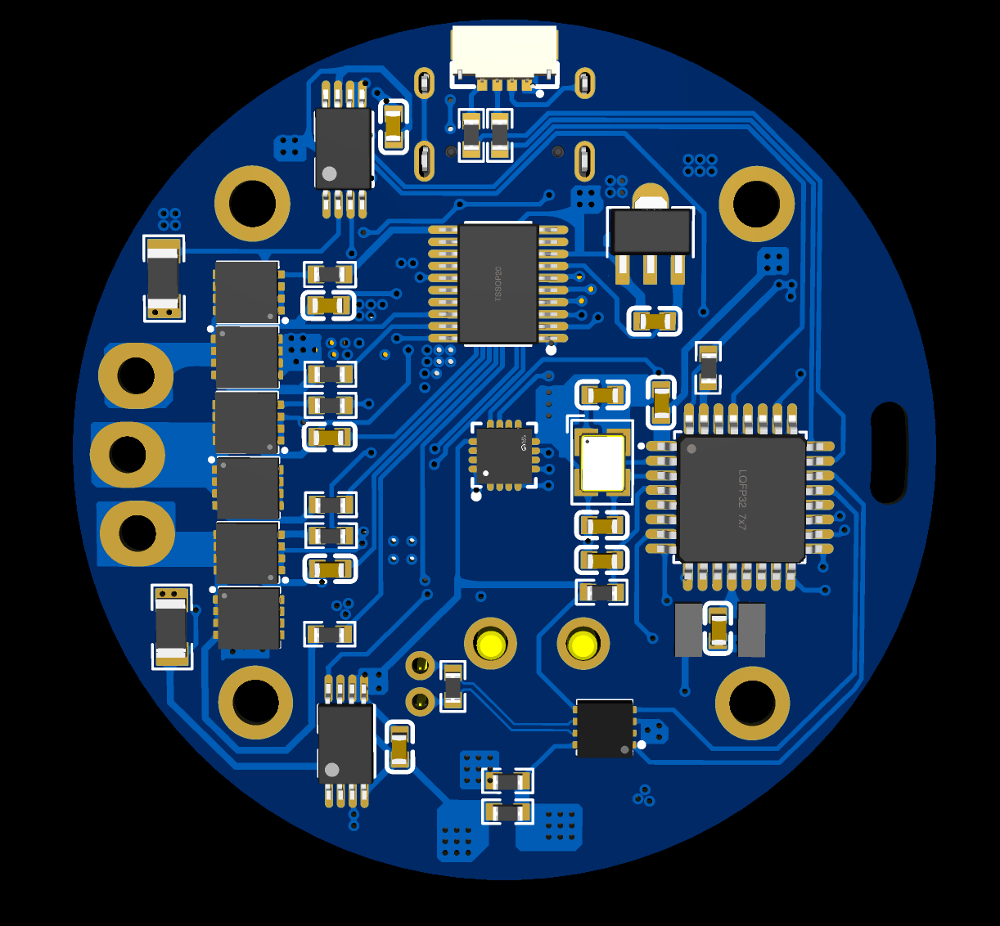
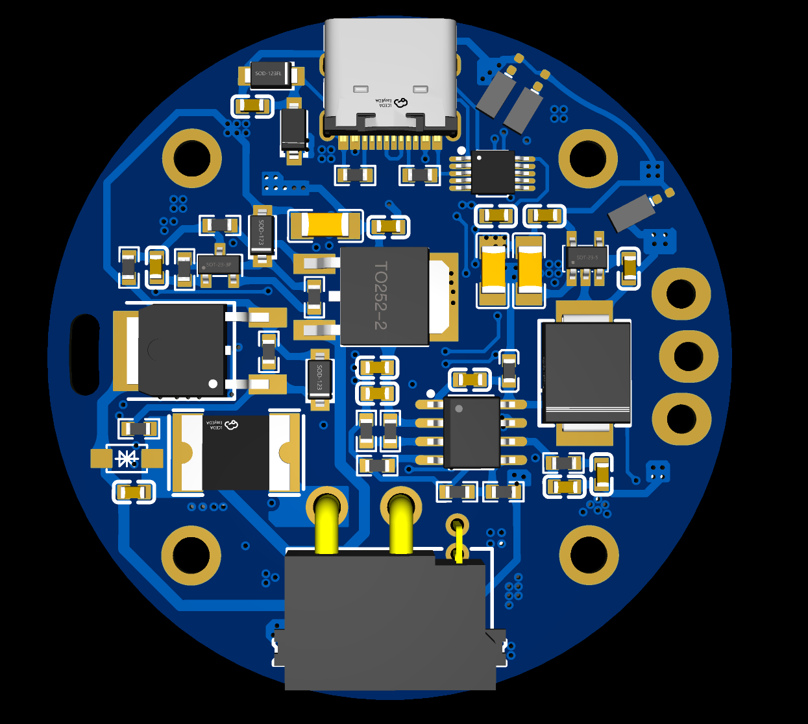

# 无刷电机驱动 · 第三代 / BLDC Motor Driver — Gen 3

> 基于 **AT32M412 + DRV8300** 的三相无刷电机驱动板，支持 CAN、SPI 磁编码器、USB 串口与 SWD 调试。
>
> A 3-phase BLDC motor driver board based on **AT32M412 + DRV8300**, with CAN, SPI magnetic encoder, USB serial and SWD debug.




---

## 简介 / Overview

本工程是第三代无刷电机驱动硬件，采用圆形小板设计，适合直接安装在电机尾部。主控为雅特力 **AT32M412KBT7**（Cortex-M4F，180 MHz），栅极驱动使用 TI **DRV8300**，功率级为 6 颗 60 V N 沟道 MOSFET，配合双 20 mΩ 采样电阻实现两相电流检测。

This is the third-generation BLDC motor driver hardware. The circular PCB is designed to be mounted directly on the back of a motor. The MCU is an Artery **AT32M412KBT7** (Cortex-M4F, 180 MHz), the gate driver is TI **DRV8300**, and the power stage uses six 60 V N-channel MOSFETs with two 20 mΩ shunts for two-phase current sensing.

**网表规模 / Netlist:** 97 components, 83 nets.

---

## 硬件规格 / Specifications

| 项目 / Item | 规格 / Spec |
|---|---|
| **主控 / MCU** | AT32M412KBT7, Cortex-M4F @180 MHz, LQFP-32 |
| **栅极驱动 / Gate driver** | TI DRV8300DPWR, 3-phase, TSSOP-20, 内置自举二极管 |
| **功率级 / Power stage** | 6 × N-MOSFET 60 V（上桥 Q1/Q2/Q4，下桥 Q6/Q7/Q12） |
| **输入 / Input** | 24 V DC（XT30PW 2+2 连接器，同时走 CAN） |
| **降压 / Buck** | TPS5430：24 V → 5 V；AMS1117-3.3：5 V → 3.3 V |
| **栅极供电 / Gate supply** | MD7680 15 V LDO → GVDD |
| **电流采样 / Current sense** | 2 × 20 mΩ 分流电阻（R2/R3）+ RSA240AXQ 运放 |
| **PWM / PWM** | TMR1 CH1~CH3 + CH1C~CH3C 硬件互补，带死区 |
| **编码器 / Encoder** | SPI 磁编码器接口（KTH7823-X-N-QN16） |
| **通信 / Comm** | CAN（SIT1051ATQ + 120 Ω 终端）、USB-C + CH340E 串口 |
| **调试 / Debug** | SWD（CN2，4 pin） |
| **保护 / Protection** | 反接保护 MOSFET、TVS、过压保护、自恢复保险丝 |

---

## 功能框图 / Block Diagram

```
XT30PW(2+2) ──┬── 反接保护(Q8) ── VBAT0 ──┬── 三相 MOSFET 桥 ── U / V / W
 24V + CAN    │                            │      (6× 60V N-MOS)
              ├── TVS + 过压保护            └── 自举电容 C7/C8/C9
              │
              ├── TPS5430 (24V→5V) ──┬── AMS1117 (5V→3.3V) ── MCU / 编码器
              │                      ├── CAN 收发器 SIT1051
              │                      └── CH340E ←── USB-C
              │
              └── MD7680 (15V) ── GVDD (栅极驱动供电)
```

---

## 接口说明 / Connectors

| 接口 / Connector | 型号 / Part | 引脚 / Pins | 说明 / Description |
|---|---|---|---|
| 电源 + CAN | XT30PW(2+2) (U12) | VBAT, BAT_NEG, CAN_L, CAN_H | 24 V 输入 + CAN 总线 |
| USB | Type-C (U10) | VBUS, GND, D+, D-, CC1/CC2 | 供电 + 串口（CH340E） |
| 烧录 | CN2（4 pin） | 3.3V, GND, SWDCLK, SWDIO | SWD 下载调试 |
| 编码器 | U16 | 3.3V, GND, CS, SCLK, MISO, MOSI, MGH, MGL | SPI 磁编码器 |
| 三相输出 | 焊盘 / Pads | U, V, W | 接电机三相 |

---

## 目录结构 / Repository Structure

```
.
├── hardware/
│   └── 无刷电机驱动.epro2      # 嘉立创EDA专业版工程（原理图 + PCB）
├── images/
│   ├── 3d-view-1.png
│   └── 3d-view-2.png
├── docs/
│   └── netlist.md              # 网表（97 器件 / 83 网络）
├── README.md
└── LICENSE
```

---

## 打开工程 / Opening the Project

1. 安装 **嘉立创EDA专业版**（EasyEDA Pro），版本 ≥ 3.2.149
   Install **EasyEDA Pro**, version ≥ 3.2.149
2. 直接双击 `hardware/无刷电机驱动.epro2`，或在 EDA 中选择「打开工程」
   Double-click `hardware/无刷电机驱动.epro2`, or use "Open Project" in the EDA
3. 工程包含原理图、PCB 与 3D 模型
   The project contains schematic, PCB and 3D models

> 注意：`.epro2` 为压缩包格式，直接解压可看到内部 JSON/WebP 数据，但建议用 EDA 打开。
> Note: `.epro2` is a ZIP archive; open it with EasyEDA Pro rather than extracting it.

---

## 设计要点 / Design Notes

- **栅极驱动接线**：BSTx 与 SHx 之间接自举电容（C7/C8/C9 = 100 nF），GVDD 接 10 µF（C6）；六路栅极均串 22 Ω 电阻
  Bootstrap capacitors (100 nF) between BSTx and SHx, 10 µF on GVDD, 22 Ω gate resistors on all six gates.
- **互补 PWM**：INH1~3 接 TMR1_CH1~CH3，INL1~3 接 TMR1_CH1C~CH3C，硬件死区
  Complementary PWM: INH1–3 from TMR1_CH1–CH3, INL1–3 from TMR1_CH1C–CH3C.
- **双电阻采样**：U、V 相下桥源极各串 20 mΩ，经 RSA240AXQ 放大后送 ADC
  Two-shunt sensing on the low-side sources of phases U and V.
- **反接保护**：N-MOSFET 置于电池负极回路，栅极由分压 + 稳压管驱动
  Reverse-polarity protection with an N-MOSFET in the battery return path.

---

## 已验证 / Verified

- [x] DRV8300 20 脚（TSSOP）接线与 TI 数据手册 SLVSFG5D 完全一致
- [x] 自举电容、栅极电阻、GVDD 去耦接法正确
- [x] 三相映射 A→U, B→V, C→W
- [x] 电源链路（24 V → 5 V → 3.3 V → 15 V）完整
- [x] 网表导出与实际图纸一致（0 处差异）

## 已知事项 / Known Notes

- U11-1 / U3-1（RSA240AXQ）悬空，需确认该脚是否为 NC
- 栅极未加 G-S 下拉电阻，建议后续版本补充 10 kΩ
- U2-5 / U2-10 / U2-30（PA0 / PA1 / PB7）未使用，可留作后续扩展

---

## 许可证 / License

本项目采用 **MIT License** 开源，详见 [LICENSE](LICENSE)。

This project is released under the **MIT License**, see [LICENSE](LICENSE).

> 硬件设计文件（原理图 / PCB）可自由用于学习、修改与二次开发；如需商用请自行评估风险。
> Hardware design files may be freely used, modified and redistributed for study and further development.
